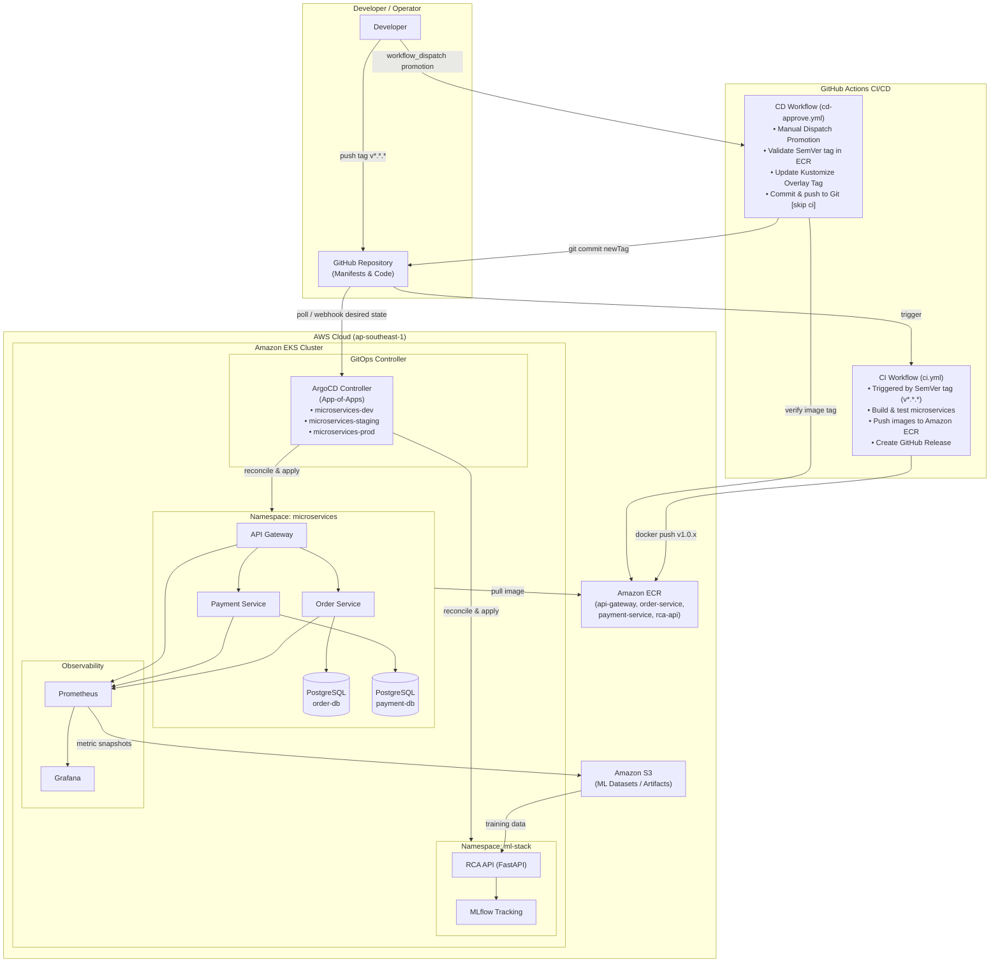

# AI-Powered Root Cause Analysis for Kubernetes Microservices

> **Status:** Active GitOps implementation.  
> Microservices, Amazon EKS infrastructure, GitHub Actions CI/CD, and ArgoCD deployment are implemented.

---

## Table of Contents

1. [Overview](#overview)
2. [Problem Statement](#problem-statement)
3. [MVP Objectives](#mvp-objectives)
4. [Architecture](#architecture)
5. [Component Responsibilities](#component-responsibilities)
6. [Repository Structure](#repository-structure)
7. [Technology Stack](#technology-stack)
8. [Implementation Roadmap](#implementation-roadmap)
9. [Development Prerequisites](#development-prerequisites)
10. [AWS Cost Considerations](#aws-cost-considerations)
11. [Project Status](#project-status)

---

## Overview

This project builds a **Machine Learning system** that automatically identifies the likely root cause of incidents in a Kubernetes-based microservices application running on AWS EKS. It combines real-time observability (Prometheus and Grafana), controlled incident generation, supervised ML classification (scikit-learn / MLflow), and a REST prediction API (FastAPI) into an end-to-end GitOps pipeline driven by **GitHub Actions** and **ArgoCD**.

The system is designed and implemented by a four-person university project team.

---

## Problem Statement

Operating a microservices application on Kubernetes introduces significant operational complexity. When an incident occurs—such as elevated error rates, increased latency, or unexpected resource consumption—identifying the root cause requires correlating metrics across many services, which is slow and error-prone when done manually.

This project addresses that problem by training a classifier on labeled observability metrics collected during controlled incidents. Once deployed, the system predicts the likely root-cause category for a given set of metrics, reducing mean time to diagnosis (MTTD).

---

## MVP Objectives

1. Deploy a minimal three-service microservices application (API Gateway, Order Service, Payment Service) on Amazon EKS.
2. Install Prometheus and Grafana to collect and visualise service metrics.
3. Run a set of controlled incidents and collect labeled metric snapshots.
4. Train a Random Forest classifier to distinguish between incident root-cause categories.
5. Track experiments and model artifacts with MLflow.
6. Expose predictions through a FastAPI endpoint (`POST /predict`).
7. Automate the build, test, and deployment pipeline using a modern GitOps workflow with GitHub Actions and ArgoCD.

The MVP does **not** include: distributed tracing, log aggregation (Loki), chaos engineering frameworks, auto-remediation, or production-grade multi-environment Terraform.

---

## Architecture

The system uses a **GitOps-driven continuous integration and deployment architecture** powered by **GitHub Actions** and **ArgoCD**, running on **Amazon EKS** in `ap-southeast-1`.



### GitOps Workflow Overview

The architecture enforces strict separation between code integration, configuration promotion, and runtime synchronization:

1. **Continuous Integration (GitHub Actions `ci.yml`)**:
   - **Trigger**: Git tag creation matching SemVer format `v*.*.*` (e.g. `v1.0.6`).
   - **Build & Push**: Builds Docker images for `api-gateway`, `order-service`, and `payment-service`. Tags each image with the exact release tag and pushes them to Amazon ECR.
   - **Release**: Automatically publishes a GitHub Release with release notes and immutable image references.

2. **Continuous Delivery & Promotion (`cd-approve.yml`)**:
   - **Trigger**: Manual `workflow_dispatch` by an authorized team member specifying target environment (`dev`, `staging`, `prod`) and `image_tag` (e.g. `v1.0.6`).
   - **Verification**: Validates SemVer formatting and verifies that the image tags actually exist in Amazon ECR via AWS CLI before touching manifests.
   - **Manifest Update**: Modifies the Kustomize overlay (`kubernetes/overlays/<env>/kustomization.yaml`) by updating the `newTag` fields.
   - **Git Commit**: Commits and pushes the manifest change back to GitHub with `[skip ci]`. Git remains the single source of truth for the cluster state.

3. **Continuous Deployment via ArgoCD (Pull-based GitOps)**:
   - **Deployment Model**: ArgoCD runs inside the EKS cluster (`argocd` namespace) and continuously compares cluster state against desired state in Git.
   - **App-of-Apps Pattern**: An overarching root application (`argocd/apps/app-of-apps.yaml`) generates environment-specific ArgoCD Applications (`microservices-dev`, `microservices-staging`, `microservices-prod`).
   - **Self-Healing & Pruning**: Automated drift detection instantly reconciles any unauthorized out-of-band changes (`selfHeal: true`, `prune: true`).
   - **Sync Waves**: `kubernetes/base/namespaces.yaml` uses `argocd.argoproj.io/sync-wave: "-1"` to guarantee namespaces (`microservices`, `ml-stack`) exist before workloads are deployed.

4. **Kustomize Base vs. Overlays Architecture**:
   - `kubernetes/base/`: Contains clean, environment-agnostic resource definitions (Deployments, Services, ConfigMaps, Namespaces). It defines *what* runs.
   - `kubernetes/overlays/<env>/`: Customizes *how* it runs in each target environment without duplicating YAML code:
     - `dev`: Replicas = 1, tracking active release tags.
     - `staging` / `prod`: Replicas = 2+, strict resource quotas, production config.
   - *Note on Legacy Directory:* The older `kubernetes/microservices/` directory contained static, non-templated manifests. It has been replaced by the structured Kustomize `base/` and `overlays/` pattern.

---

## Component Responsibilities

| Directory | Technology | Responsibility |
|-----------|-----------|----------------|
| `services/` | Python / Docker | Microservice source code (API Gateway, Order Service, Payment Service) |
| `.github/workflows/` | GitHub Actions | CI build/push on tags (`ci.yml`) and manual GitOps promotion (`cd-approve.yml`) |
| `argocd/` | ArgoCD | GitOps App-of-Apps and environment application declarations (`apps/`, `install/`) |
| `kubernetes/base/` | Kustomize / K8s | Shared environment-agnostic Kubernetes manifests (Deployments, Services, Namespaces) |
| `kubernetes/overlays/` | Kustomize / K8s | Environment-specific overlays (`dev/`, `staging/`, `prod/`) with image tags and replicas |
| `kubernetes/postgres/` | StatefulSet / PVC | Dedicated PostgreSQL database manifests for `order-db` and `payment-db` |
| `terraform/` | Terraform / AWS | Infrastructure as Code: VPC, EKS, ECR, IAM, S3 |
| `monitoring/` | Prometheus, Grafana, Helm | Metrics collection and visualisation |
| `ml/` | Python, scikit-learn, MLflow | Dataset preparation, model training, evaluation, experiment tracking |
| `rca-api/` | FastAPI, Docker | REST API serving RCA predictions |
| `jenkins/` | Jenkins | Legacy CI/CD pipeline documentation (superseded by GitHub Actions + ArgoCD) |
| `scripts/` | Bash / Python | Operational scripts: incident generation, metric collection, health checks |
| `docs/` | Markdown | Architecture documentation, dataset schema, evaluation results |

---

## Repository Structure

```
ai-root-cause-analysis/
├── README.md                   ← This file
├── .gitignore
├── .dockerignore
├── .env.example
├── .github/
│   └── workflows/
│       ├── ci.yml              ← Tag-triggered CI (build & push to ECR, GitHub release)
│       ├── cd-approve.yml      ← Manual approval CD (updates Kustomize overlays)
│       └── cicd.yml.legacy     ← Legacy monolithic pipeline
├── argocd/
│   ├── README.md               ← ArgoCD installation and setup guide
│   ├── install/                ← Namespace and core ArgoCD install manifests
│   └── apps/
│       ├── app-of-apps.yaml    ← Root application managing all environments
│       ├── microservices-dev.yaml
│       ├── microservices-staging.yaml
│       └── microservices-prod.yaml
├── services/                   ← Microservice source code (API Gateway, Order, Payment)
├── kubernetes/
│   ├── base/                   ← Kustomize base manifests (Deployments, Services, Namespaces)
│   ├── overlays/               ← Kustomize environment overlays
│   │   ├── dev/                ← Dev environment overlay (active release tags)
│   │   ├── staging/            ← Staging environment overlay
│   │   └── prod/               ← Production environment overlay
│   ├── postgres/               ← Dedicated PostgreSQL databases (order-db, payment-db)
│   └── README.md               ← Kubernetes & Kustomize documentation
├── terraform/                  ← AWS infrastructure (VPC, EKS, ECR, IAM, S3)
├── monitoring/                 ← Prometheus and Grafana setup documentation
├── ml/                         ← ML pipeline documentation and training scripts
├── rca-api/                    ← FastAPI RCA prediction service documentation
├── jenkins/                    ← Legacy CI/CD documentation
├── scripts/                    ← Operational scripts (incident generation, verification)
└── docs/                       ← Architecture and methodology documentation
```

---

## Technology Stack

| Category | Technology | Version target |
|----------|-----------|----------------|
| Cloud | AWS (VPC, EKS, ECR, IAM, S3) | Current |
| Infrastructure as Code | Terraform | ≥ 1.10 (for S3 native locking) |
| Container runtime | Docker | Current stable |
| Orchestration | Kubernetes | ≥ 1.29 (EKS managed) |
| Manifest Management | Kustomize | Built into kubectl / ArgoCD |
| GitOps CD | ArgoCD | ≥ 2.10 |
| CI Pipeline & Automation | GitHub Actions | Current |
| Observability | Prometheus, Grafana | Helm kube-prometheus-stack |
| ML framework | scikit-learn | ≥ 1.4 |
| Experiment tracking | MLflow | ≥ 2.x |
| Prediction API | FastAPI | ≥ 0.111 |
| Databases | PostgreSQL | ≥ 15 (Alpine) |
| Language | Python | ≥ 3.11 |
| Version control | Git, GitHub | — |

---

## Implementation Roadmap

### Phase 1 — Repository Initialisation
- Create the project skeleton, directory structure, and README files.
- Establish `.gitignore`, `.dockerignore`, and `.env.example`.
- Document the S3 remote-state design and Terraform workflow.

### Phase 2 — Bootstrap Terraform Remote State
- Create the S3 state bucket manually (or with a dedicated bootstrap script) in `ap-southeast-1`.
- Enable Block Public Access, versioning, and SSE-S3 encryption on the bucket.
- Run `terraform init` in `terraform/` to migrate local state to S3.
- Commit `.terraform.lock.hcl` after initialization.

### Phase 3 — Provision AWS Infrastructure
- Author Terraform configuration for VPC, subnets, Internet Gateway, NAT Gateway, EKS cluster, managed node group, IAM roles, and ECR repositories.
- Run `terraform plan` and review; run `terraform apply` after team sign-off.

### Phase 4 — Build and Push Container Images (CI)
- Write Dockerfiles for each microservice (`api-gateway`, `order-service`, `payment-service`, `rca-api`).
- Configure GitHub Actions CI (`ci.yml`) to automatically build and push SemVer-tagged images (`v*.*.*`) to Amazon ECR.

### Phase 5 — Deploy Microservices to EKS via GitOps (CD)
- Author Kustomize base manifests (`kubernetes/base/`) and environment overlays (`kubernetes/overlays/dev`, `staging`, `prod`).
- Deploy PostgreSQL stateful workloads for Order and Payment services.
- Configure ArgoCD App-of-Apps for automated, declarative GitOps deployments.

### Phase 6 — Install Prometheus and Grafana
- Deploy `kube-prometheus-stack` via Helm.
- Configure scrape targets and verify metrics are collected.
- Import or build Grafana dashboards for key service metrics.

### Phase 7 — Incident Generation and Metric Collection
- Write scripts to inject controlled incidents (CPU stress, payment failure, database slowness).
- Collect labeled metric snapshots and store them in S3.

### Phase 8 — Train and Evaluate the ML Model
- Prepare the dataset and engineer features from raw metrics.
- Train a threshold-based baseline and a Random Forest classifier.
- Evaluate with Precision, Recall, Macro-F1, and a confusion matrix.

### Phase 9 — Track Experiments with MLflow
- Log parameters, metrics, and model artifacts to MLflow for each run.
- Register the best model in the MLflow Model Registry.

### Phase 10 — Deploy the RCA API
- Implement the FastAPI service with `GET /health` and `POST /predict`.
- Package as a Docker image, push to ECR, and deploy to EKS.
- Load the registered MLflow model artifact at startup.

### Phase 11 — GitOps Release Promotion & CD Approval
- Implement `cd-approve.yml` manual promotion workflow.
- Validate release image tags against ECR using AWS credentials / OIDC.
- Automatically update Kustomize overlays and sync changes via ArgoCD self-healing.

### Phase 12 — End-to-End Evaluation
- Run a full incident scenario and verify that the RCA API returns the correct root-cause class.
- Document results, latency, and model accuracy in `docs/`.

---

## Development Prerequisites

The following tools must be installed on each developer's machine before starting work:

| Tool | Minimum version | Installation reference |
|------|----------------|----------------------|
| AWS CLI | v2 | https://docs.aws.amazon.com/cli/latest/userguide/install-cliv2.html |
| Terraform | ≥ 1.10 | https://developer.hashicorp.com/terraform/install |
| kubectl | Matches EKS version | https://kubernetes.io/docs/tasks/tools/ |
| Helm | ≥ 3.14 | https://helm.sh/docs/intro/install/ |
| Docker Desktop | Current stable | https://www.docker.com/products/docker-desktop |
| Python | ≥ 3.11 | https://www.python.org/downloads/ |
| Git | ≥ 2.40 | https://git-scm.com/downloads |

Authenticate the AWS CLI with an IAM identity that has appropriate permissions before running any Terraform or `kubectl` commands:

```bash
aws configure          # or set AWS_PROFILE / AWS_DEFAULT_REGION
aws sts get-caller-identity   # verify your identity
```

---

## AWS Cost Considerations

Running the MVP incurs AWS charges. The main cost drivers are:

| Resource | Approximate cost indicator |
|----------|--------------------------|
| EKS cluster control plane | ~USD 0.10/hour |
| EC2 node group (e.g., 2× t3.medium) | ~USD 0.04–0.09/hour per node |
| NAT Gateway | ~USD 0.045/hour + data transfer |
| Application Load Balancer | ~USD 0.008/hour + LCU charges |
| ECR storage | Low for MVP image sizes |
| S3 (state, datasets) | Negligible for MVP data volumes |

**Cost control actions:**
- Destroy the EKS cluster and node group when not actively working (`terraform destroy`).
- Do **not** destroy the S3 state bucket with the main infrastructure unless you are retiring the project entirely.
- Set up an AWS Budget alert at a comfortable threshold before applying infrastructure.
- Use `t3.medium` or smaller instance types for the node group during development.

---

## Project Status

| Component | Status |
|-----------|--------|
| Repository skeleton and documentation | ✅ Complete |
| S3 remote-state design | ✅ Documented |
| AWS infrastructure (Terraform VPC, EKS, ECR) | ✅ Provisioned |
| Microservice source code (Gateway, Order, Payment) | ✅ Complete |
| Kubernetes Kustomize Base & Overlays | ✅ Implemented |
| Dedicated PostgreSQL Databases | ✅ Deployed |
| ArgoCD GitOps Engine (App-of-Apps) | ✅ Deployed & Active |
| GitHub Actions CI/CD (SemVer Tag & CD Approve) | ✅ Deployed & Active |
| Prometheus / Grafana setup | ✅ implemented |
| Incident generation scripts | ⏳ Not started |
| ML training pipeline | ⏳ Not started |
| MLflow integration | ⏳ Not started |
| RCA API (FastAPI) | ⏳ Staged for ML integration |

---

*Project team: four-person university group. Questions or contributions: open a GitHub issue or pull request.*
